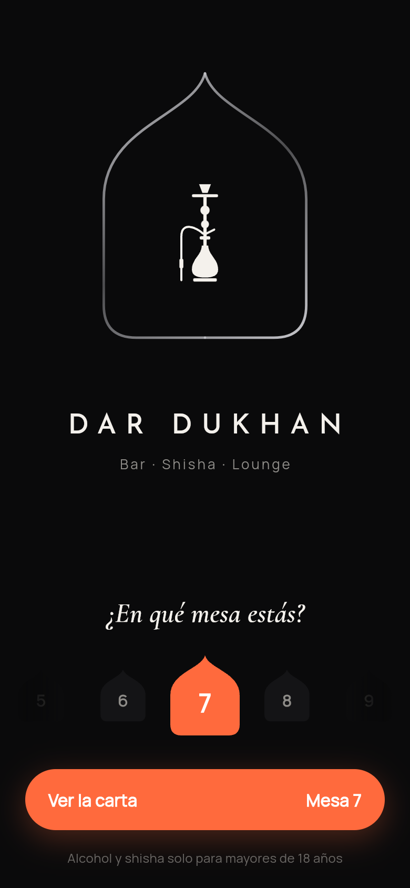
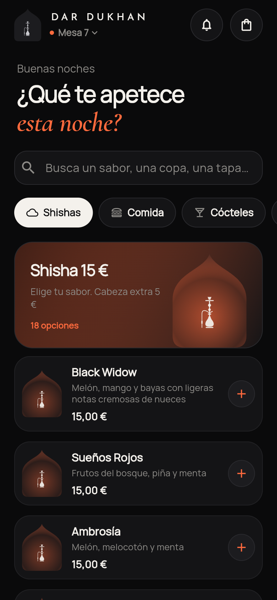
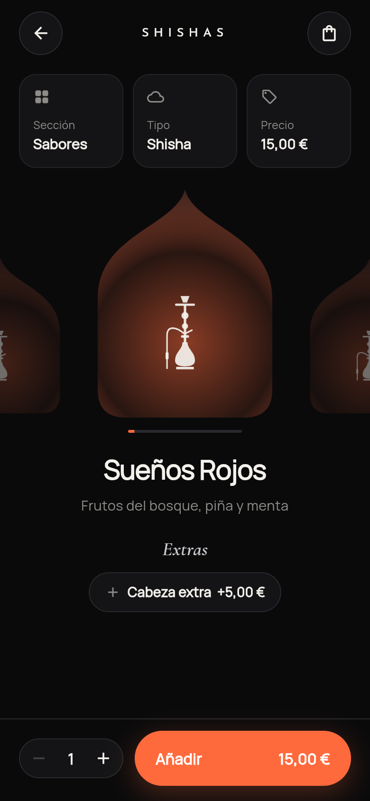
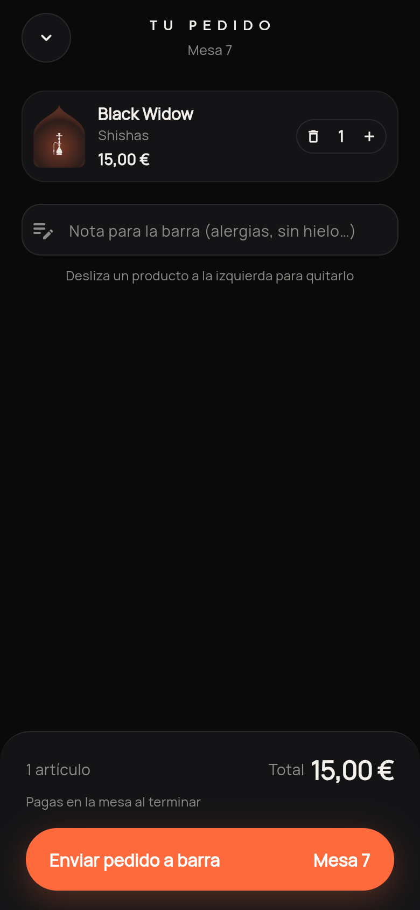
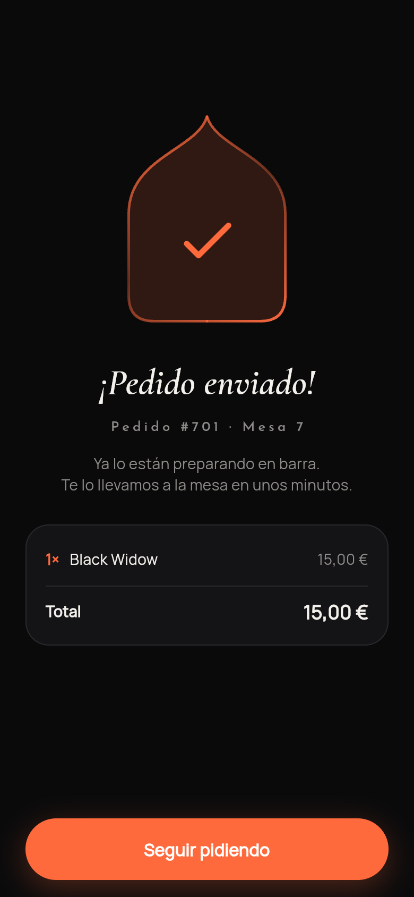

# Dar Dukhan · Carta y pedidos en mesa

App Flutter para pedir desde la mesa en **Dar Dukhan – Bar Shisha Lounge**. No es para domicilio:
el cliente elige su mesa (o la abre desde un QR con `?mesa=7`), mira la carta, añade productos
y envía el pedido a barra.

| Bienvenida | Carta | Ficha | Pedido | Confirmación |
|---|---|---|---|---|
|  |  |  |  |  |

## Diseño

- **Oscuro y minimalista**: negro profundo, plata de la marca y un único acento brasa (naranja salmón).
- **El arco de la marca** como elemento de sistema: logo animado, selector de mesa, ilustraciones de
  producto y confirmación usan la misma silueta.
- **Animaciones**: arco que se dibuja al entrar, carrusel de productos con escala/opacidad,
  listas escalonadas, contador del pedido, barra de pedido que entra con rebote, check final.
- Tipografía: Manrope (texto), Josefin Sans (marca), Cormorant Garamond itálica (títulos, eco de la carta).
  Las fuentes van empaquetadas en `assets/google_fonts/` (licencia OFL), así funciona sin internet.

## Estructura

```
lib/
  main.dart                 arranque, mesa desde ?mesa= en web
  theme.dart                paleta, tipografías, formato de precios
  data/models.dart          Category, MenuItem, Extra
  data/menu_data.dart       carta completa transcrita de los PDF
  state/order.dart          pedido en curso (ChangeNotifier + InheritedNotifier)
  widgets/arch.dart         arco, silueta de shisha, ilustración de producto
  widgets/common.dart       botones, stepper, píldoras, animaciones
  screens/                  bienvenida, carta, ficha, pedido, confirmación
```

## Ejecutar

```bash
flutter pub get
flutter run                 # móvil
flutter run -d chrome       # web (p. ej. http://localhost:xxxx/?mesa=7)
flutter test
```

## Pendiente

- **Envío real a barra**: `Order.submit()` hoy simula el envío. Falta conectar un backend
  (Firebase/Supabase o el TPV del local) y una pantalla para barra/cocina.
- Alérgenos de la carta de comida (los iconos del PDF no son legibles).
- Revisar con el local: precio con carbón natural (12 €) frente a shisha 15 € y nombres con erratas
  ("Swees Boom", "Mango Tanko Iss", "Blu Iss" se han mantenido tal cual).
